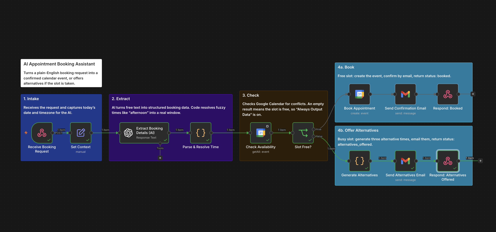

# AI Appointment Booking Assistant

An n8n workflow that turns a plain-English booking request into a confirmed Google Calendar event, or offers alternative times if the slot is already taken.

**Demo video:** [Watch the demo](https://www.loom.com/share/f9f3f36a26a947a8acefbe4ca534a2aa)



## What it does

Send a POST request containing a message such as *"book a call next Tuesday afternoon"*, plus the person's name and email. The workflow:

1. Uses an AI model to extract the intent, date and time of day from the message.
2. Resolves fuzzy phrases like "afternoon" into a fixed 30-minute slot using code, not the AI.
3. Checks Google Calendar for a conflict at that time.
4. **If the slot is free:** creates the calendar event, emails a confirmation, and returns `status: booked`.
5. **If the slot is busy:** generates three alternative times, emails them, and returns `status: alternatives_offered`.

## Workflow

| Stage | Nodes | Purpose |
|---|---|---|
| 1. Intake | Receive Booking Request, Set Context | Receives the request and captures today's date and timezone for the AI |
| 2. Extract | Extract Booking Details (AI), Parse & Resolve Time | AI returns structured JSON; code turns it into a real time slot |
| 3. Check | Check Availability, Slot Free? | Looks for events at that time and branches on the result |
| 4a. Book | Book Appointment, Send Confirmation Email, Respond: Booked | Creates the event, confirms by email, responds to the caller |
| 4b. Offer alternatives | Generate Alternatives, Send Alternatives Email, Respond: Alternatives Offered | Suggests three other times, emails them, responds to the caller |

## Example

**Request**

```bash
curl -X POST YOUR_WEBHOOK_URL \
  -H "Content-Type: application/json" \
  -d '{"message": "book a call next Tuesday afternoon", "email": "jane@example.com", "name": "Jane Doe"}'
```

**Response when the slot is free**

```json
{ "status": "booked", "time": "2026-10-20T14:00:00.000+01:00" }
```

**Response when the slot is taken**

```json
{
  "status": "alternatives_offered",
  "options": [
    { "start_iso": "2026-10-20T15:00:00.000+01:00", "end_iso": "2026-10-20T15:30:00.000+01:00", "display": "Tuesday, 20 October at 3:00 PM" },
    { "start_iso": "2026-10-20T16:00:00.000+01:00", "end_iso": "2026-10-20T16:30:00.000+01:00", "display": "Tuesday, 20 October at 4:00 PM" },
    { "start_iso": "2026-10-21T14:00:00.000+01:00", "end_iso": "2026-10-21T14:30:00.000+01:00", "display": "Wednesday, 21 October at 2:00 PM" }
  ]
}
```

## Design decisions

- **The AI extracts, the code decides.** The AI only turns text into structured fields. Time-of-day defaults live in code (morning 10:00, afternoon 14:00, evening 17:00), so the same request always produces the same slot.
- **Exact times win.** If the message contains a specific time ("at 10am"), it is used instead of the default for that period.
- **Timezone is preserved end to end.** The workflow parses times with the original UTC offset kept, so suggested alternatives display in the correct local time.
- **An empty calendar result is a valid answer.** n8n stops a workflow when a node returns nothing. `Check Availability` has *Always Output Data* switched on, so "no events found" continues down the free-slot branch.

## Setup

**You will need**

- n8n (self-hosted, e.g. with Docker)
- A Google Cloud project with the **Google Calendar API** and **Gmail API** enabled
- An OAuth 2.0 client (Web application) with the n8n callback as its redirect URI, for example `http://localhost:5678/rest/oauth2-credential/callback`
- An OpenAI API key

**Steps**

1. Import `appointment-booking-workflow.json` into n8n.
2. Create credentials for Google Calendar (OAuth2), Gmail (OAuth2) and OpenAI, then select them on the relevant nodes.
3. Choose your calendar in **Check Availability** and **Book Appointment**.
4. In **Set Context**, set `user_timezone` to your timezone (default `Europe/London`).
5. Publish the workflow and send a test request to the production webhook URL.

If your Google OAuth app is in testing mode, add yourself as a test user. Tokens for testing-mode apps expire after about a week and need reconnecting.

## Limitations and next steps

- Unclear requests are flagged inside the workflow but not yet handled. Next step: an error branch that emails the sender asking for a date and time.
- Suggested alternatives are offsets (+1 hour, +2 hours, +1 day) and are not checked against the calendar.
- Time-of-day defaults and the 30-minute duration are fixed in code.
- The timezone is set once in `Set Context` rather than per request.
- The sender can't reply to pick an alternative; it is offered by email only.

## Built with

n8n · OpenAI (gpt-4.1-mini) · Google Calendar API · Gmail API · Docker
